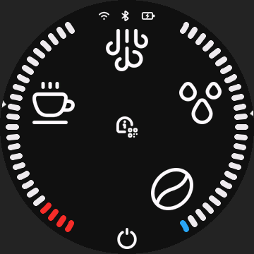
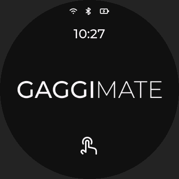

# GaggiMate Knob Screen

GaggiMate display firmware adapted for the **GUITION JC3636K718C_I_YR1** round knob screen.
Based on [GaggiMate v1.9.0](https://github.com/jniebuhr/gaggimate/tree/v1.9.0), with native 360 × 360 rendering and controller protocol 5.

This is an independent display port maintained by [Bridgee](https://github.com/Bridgee).
It retains the upstream page structure and coffee-control logic while adapting the display hardware and adding knob-screen features.

## Hardware and features

- ESP32-S3, 16 MB flash, 8 MB PSRAM; ST77916 display and CST816S touch.
- Native display, touch, backlight, Wi-Fi/web interface and Bluetooth controller connection.
- Battery/power-source icon on the menu and standby screens, with low-battery colors.
- Rotary parameter adjustment: direct on single-field pages; tap to select on multi-field pages. Original +/− buttons remain available.
- Configurable standby text or a centered clock.
- Optional LED-ring mirror of the displayed temperature and pressure bars.
- Callable LED, speaker and microphone interfaces; no hardware-test web page.

 

## Status

The current source is **port 0.3.5 — development**. It is not a new stable firmware release.
Earlier builds have been used on the target screen; each published binary must have its own release status and checksums.
Controller firmware is not modified by this port.

Display updates currently use **USB and a K718 build**. Installing the stock LilyGO display image through upstream OTA is blocked.
Battery percentage is an uncalibrated voltage estimate; the lightning symbol means external power, not measured charging current.
LED mode and brightness currently reset at reboot.

## Build and install

The pinned full-build tool package currently supports **Apple Silicon with macOS 26 or later**.
Start with [Building and flashing](docs/BUILDING.md). Build commands never flash a device automatically.

```sh
python3.12 -m venv .venv
source .venv/bin/activate
python -m pip install -r port/requirements.lock.txt
nvm install
nvm use
npm install --global npm@11.6.2
python scripts/k718.py doctor
python scripts/k718.py build --out dist/release
```

## Repository

| Path | Contents |
| --- | --- |
| `src/`, `lib/`, `boards/` | Firmware and board drivers |
| `eez-ui/`, `assets/`, `icons/`, `web/`, `data/` | UI sources, resources and default profiles |
| `port/` | Port configuration, pinned dependencies and build-tool inputs |
| `scripts/`, `test/`, `sim/` | Build/replay tools and automated firmware tests |
| `docs/` | Build, hardware and maintenance references |

- [Hardware interfaces](docs/HARDWARE.md)
- [Maintaining and updating the port](docs/MAINTAINING.md)
- [Changelog](CHANGELOG.md)

Firmware binaries belong in GitHub Releases, not the source tree. Local device data and development records are excluded.

## Credits and license

Original GaggiMate firmware by [Caffinnova S.r.l. and the GaggiMate contributors](https://gaggimate.eu/).
Knob-screen adaptation and maintenance by [Bridgee](https://github.com/Bridgee/gaggimate-knob-screen).

GaggiMate is distributed under [CC BY-NC-SA 4.0](LICENSE.md). Third-party components retain their own licenses; see [NOTICE.md](NOTICE.md).
