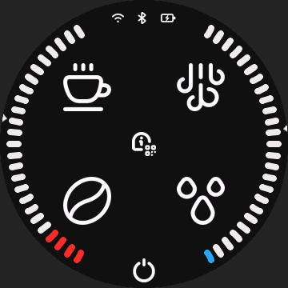
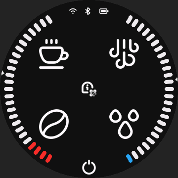
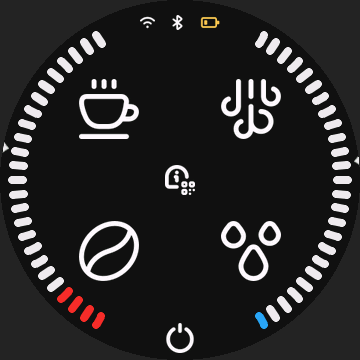
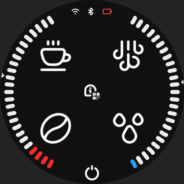
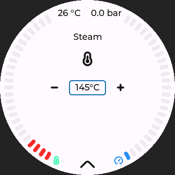
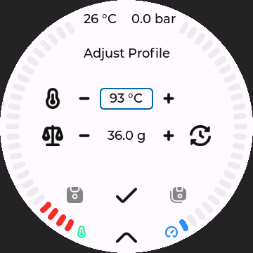
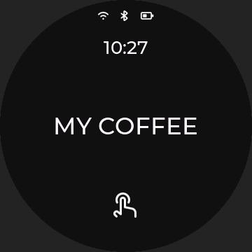
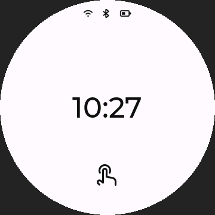

# GaggiMate Knob Screen

[](https://github.com/Bridgee/gaggimate-knob-screen/actions/workflows/build.yml)

GaggiMate screen firmware adapted and maintained for the **GUITION JC3636K718C_I_YR1** battery-powered knob screen.
Based on official [GaggiMate v1.9.0](https://github.com/jniebuhr/gaggimate/tree/v1.9.0), with **native 360 × 360 UI** and **controller protocol 5**.

This is an independent port maintained by [Bridgee](https://github.com/Bridgee). It preserves the upstream coffee-control logic, page flows and original touch buttons, then adds the hardware adaptation and optional knob-screen extensions below.

## What this port adds

- Native display, touch and backlight support; upstream Wi-Fi/web and Bluetooth controller communication remain available.
- Battery/power-source icons on both the menu and standby screens, including low-battery colors.
- Rotary parameter adjustment: direct on single-field pages; tap to select on multi-field pages. Original +/− buttons remain available.
- Optional LED-ring temperature/pressure bars, following the screen colors. Enable the ring and set its brightness in **Settings → General → LED Ring**; saved preferences survive restarts.
- Custom standby text or a centered clock, with both themes and touch wake.
- Callable speaker and microphone interfaces. The temporary hardware-test page has been removed.
- Locked build inputs, official-base patch replay and reproducible firmware builds.

## Feature previews

Native 360 × 360 UI renders with simulated values, not device photographs. The examples illustrate power status, rotary focus and standby customization, with both themes represented.

### Power status

| External power | Battery power (high) |
| :---: | :---: |
|  |  |
| **Battery power (low)** | **Battery power (critical)** |
|  |  |

Menu examples have the optional grinder enabled. The lightning symbol indicates external power. On battery, the icon shows estimated fill level, turning yellow at 25% or below and red at 10% or below.

### Rotary adjustment

| Single field: turn directly | Multiple fields: tap a value, then turn |
| :---: | :---: |
|  |  |

The blue outline identifies the field controlled by the knob. Original +/− touch buttons remain available.

### Custom standby content

| Your text | Centered clock only |
| :---: | :---: |
|  |  |

Choose the layout in **Settings → General → Standby Content**. Status icons and touch wake remain available.

[Image sources and regeneration](docs/images/README.md).

## Hardware

Target: **GUITION JC3636K718C_I_YR1**, the complete round-screen unit with base, battery, RGB ring, speaker and microphone.
You may find this screen on [AliExpress](https://www.aliexpress.com/); verify the exact model and 360 × 360 hardware variant before ordering.

| Component | Configuration |
| --- | --- |
| MCU / memory | ESP32-S3, 16 MB flash, 8 MB PSRAM |
| Display / touch | ST77916 QSPI, 360 × 360; CST816S |
| Input | Capacitive touch and outer rotary ring |
| LEDs | 12 addressable RGB LEDs |
| Audio | I2S speaker output and PDM microphone |
| Power | Battery and USB; SYS-voltage-based battery estimate |

Manufacturer manuals, schematics and examples: [Official K718 English package](https://pan.jczn1688.com/directlink/1/HMI%20display/JC3636K718_knob_EN.zip).

Pin assignments, callable interfaces and limitations are in [Hardware interfaces](docs/HARDWARE.md).

## From official firmware to this port

```text
Official GaggiMate v1.9.0
  → K718 display/touch/backlight and board interfaces
  → native 360 × 360 geometry, fonts, images and touch coordinates
  → battery status, LED gauges, rotary adjustments and standby options
  → locked build, software checks, USB installation and versioned releases
```

The port compiles a generated native UI from the original EEZ inputs. It does not rescale complete rendered frames at runtime.
Original page event handlers and flow logic are checked automatically. Controller, PID and process-execution sources retain upstream behavior.
See [Port architecture and migration](docs/PORTING.md) for the implementation map and exact reconstruction steps.

## Releases and compatibility

The development candidate is **0.3.6-rc.1**, including persistent LED controls. The latest published candidate is **[v0.3.6-rc.1](https://github.com/Bridgee/gaggimate-knob-screen/releases/tag/v0.3.6-rc.1)**, based on GaggiMate v1.9.0 / protocol 5.
It is a **pre-release**: software/build checks do not imply hardware acceptance of this exact binary. Release notes identify the tested scope and artifact hashes.

- Update the display over **USB using a K718 build**. OTA installation for both the display and controller is disabled in the knob-screen firmware. Official update checks and notifications remain enabled; update notices do not confirm port compatibility.
- Battery percentage is uncalibrated. The lightning symbol means external power, not measured charging current.
- LED-ring preferences are saved on the screen. The ring remains off in standby and while the controller is disconnected.
- Speaker/microphone interfaces have been exercised; continuous audio, audio quality and optional haptics are not qualified.

Successful CI runs provide development firmware bundles under Actions. Versioned public packages are published under [Releases](https://github.com/Bridgee/gaggimate-knob-screen/releases).

CI also prepares a [matched firmware pair](docs/MAINTAINING.md#matched-firmware-pairs): our K718 application plus the unmodified official controller application, with pinned source identities, separate versions and SHA-256 checksums. This prepares distribution inputs; OTA installation remains disabled.

## Build

The pinned full-build tool package currently supports **Apple Silicon with macOS 26 or later**.

```sh
python3.12 -m venv .venv
source .venv/bin/activate
python -m pip install -r port/requirements.lock.txt
nvm install
nvm use
npm install --global npm@11.6.2
python scripts/k718.py doctor
python scripts/k718.py build --out dist/release
```

Build commands never flash a device automatically. See [Building and flashing](docs/BUILDING.md) for USB installation and rollback.

## Development and maintenance

| Path | Purpose |
| --- | --- |
| `src/`, `lib/`, `boards/` | Firmware, board drivers and hardware interfaces |
| `eez-ui/`, `assets/`, `icons/`, `web/`, `data/` | UI inputs, resources, web application and default profiles |
| `port/` | Compatibility metadata, dependency/tool locks and build inputs |
| `scripts/`, `test/`, `sim/` | Build/replay tools and automated firmware tests |
| `docs/` | Build, hardware, porting and maintenance references |

- [Port architecture and migration](docs/PORTING.md)
- [Maintaining and updating the port](docs/MAINTAINING.md)
- [Roadmap](docs/ROADMAP.md)
- [Changelog](CHANGELOG.md)

Source and firmware build inputs belong here. Device dumps, credentials, raw test records and personal development material do not.

## Credits and license

Original GaggiMate firmware by [Caffinnova S.r.l. and the GaggiMate contributors](https://gaggimate.eu/).
Knob-screen adaptation, extensions and maintenance by [Bridgee](https://github.com/Bridgee/gaggimate-knob-screen).

GaggiMate is distributed under [CC BY-NC-SA 4.0](LICENSE.md). Third-party components retain their own licenses; see [NOTICE.md](NOTICE.md).
